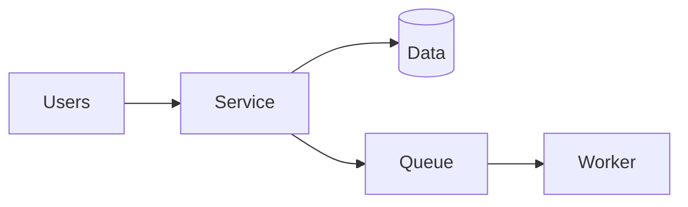

<!-- slide: title -->

# {{TITLE}}

One-line framing of the message

::: small
{{DATE}} · Draft for discussion
:::

---

## Agenda

1. Context
2. Problem
3. Options
4. Recommendation
5. Next steps

---

<!-- slide: section -->

## 01 · Context

What this is about, in one sentence

---

## Key numbers

:::: stats
::: stat
**42%**

faster deployments
:::
::: stat
**3**

teams onboarded
:::
::: stat
**0**

open incidents
:::
::::

---

## How it fits together

---

## Three problems

:::: cards
::: card
### One
Short description in one or two lines.
:::
::: card
### Two
Short description in one or two lines.
:::
::: card
### Three
Short description in one or two lines.
:::
::::

> [!WARNING]
> One sentence that must not be missed.

---

## Options

:::: cols
::: col
| Option | Verdict |
| --- | --- |
| A | [Recommended]{.yes} |
| B | [Not recommended]{.no} |
:::
::: col
- Point one
- Point two
- Point three
:::
::::

::: notes
Speaker notes: press N in the browser to show them. They never print.
:::

---

<!-- slide: statement -->

## One key message on its own slide

Supporting sentence.
