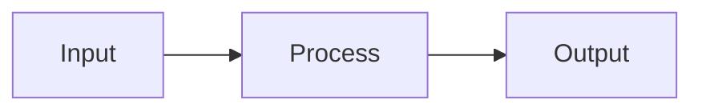

# Summary

Three to five sentences: the problem, the recommendation, what you need from the reader.

> [!IMPORTANT]
> **Decisions needed:** list them here so they are visible on page one.

# Background

Text, tables and diagrams.

# Recommendation

| Item | Detail |
| --- | --- |
| One | Detail |

# Next steps

1. Step one
2. Step two
